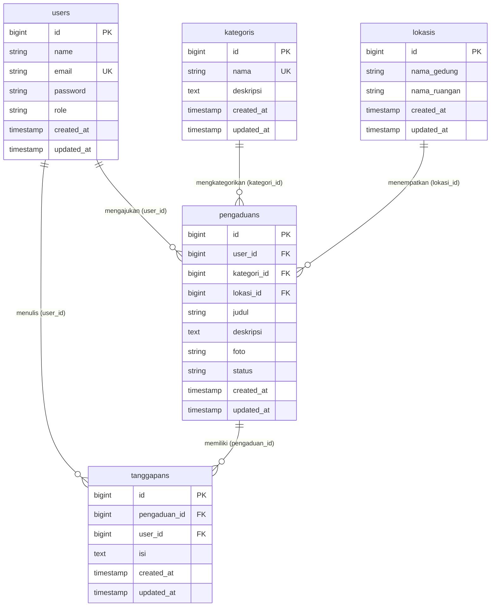

# SIPEDULI — Sistem Pengaduan Fasilitas Kampus

Tugas Pengganti UTS Praktikum Teknologi Informasi (PTI) — Semester 5.

---

## 1. Nama Aplikasi

**SIPEDULI** (Sistem Pengaduan Fasilitas Kampus)

---

## 2. Deskripsi Aplikasi

**SIPEDULI** adalah aplikasi web berbasis Laravel untuk mengelola pelaporan kerusakan sarana dan prasarana kampus secara terstruktur dan transparan. Aplikasi ini menjembatani komunikasi antara mahasiswa sebagai pelapor dengan petugas/admin pengelola fasilitas kampus agar setiap laporan memiliki kategori, lokasi presisi, bukti foto, status penanganan yang terpantau (`menunggu`, `diproses`, `selesai`, `ditolak`), serta tanggapan resmi.

---

## 3. Nama Anggota Kelompok

| No | Nama Lengkap | NIM | Pembagian Tugas |
|---|---|---|---|
| 1 | `[Nama 1 - NIM]` | `[NIM]` | Setup proyek, autentikasi & role, middleware, CRUD Kategori & Lokasi, seeder, README |
| 2 | `[Nama 2 - NIM]` | `[NIM]` | Model & relasi, CRUD Pengaduan (upload foto), CRUD Tanggapan & status, policy, dashboard |

---

## 4. Fitur Utama

### A. Autentikasi & Kontrol Akses Berbasis Peran (`mahasiswa`, `petugas`, `admin`)
- Login, registrasi mandiri (otomatis menjadi `mahasiswa`; kolom `role` diproteksi di server), dan tombol **Keluar** di navbar.
- Pembatasan akses menggunakan `RoleMiddleware` untuk rute admin/petugas dan `PengaduanPolicy` untuk kepemilikan serta status laporan (mengembalikan HTTP `403` jika tidak berhak).

### B. Fitur per Peran
- **Mahasiswa:**
  - Dashboard ringkasan statistik pengaduan milik sendiri.
  - Mengajukan pengaduan kerusakan fasilitas beserta upload foto pendukung (JPG/JPEG/PNG, maks 2 MB).
  - Melihat daftar, detail, dan tanggapan petugas atas laporannya.
  - Mengubah dan menghapus pengaduan miliknya sendiri **hanya selama status masih `menunggu`**.
- **Petugas:**
  - Dashboard ringkasan seluruh laporan kampus dan filter pengaduan berdasarkan status.
  - Memberikan, mengubah, dan menghapus tanggapan miliknya pada halaman detail pengaduan.
  - Memperbarui status pengaduan (`menunggu`, `diproses`, `selesai`, `ditolak`).
- **Admin:**
  - Seluruh hak akses Petugas ditambah moderasi hapus pengaduan/tanggapan.
  - CRUD Master Data **Kategori** dan **Lokasi** (gedung & ruangan), dilengkapi proteksi agar data yang masih dipakai pengaduan tidak dapat dihapus sembarangan.

### C. Pengalaman Pengguna & Keamanan Dasar
- Alert notifikasi terpusat (`success`, `error`, `warning`, `info`, dan ringkasan validasi) serta **Modal Konfirmasi Bootstrap 5** sebelum proses hapus di seluruh CRUD.
- Proteksi `@csrf` pada semua form, validasi input di server per field, pagination Bootstrap 5, dan eager loading (`with()`).

---

## 5. Teknologi yang Digunakan

| Komponen | Teknologi |
|---|---|
| Backend Framework | Laravel 13.x (PHP 8.3) |
| Database | PostgreSQL (driver `pgsql` / `pdo_pgsql`) |
| Database Management | pgAdmin 4 |
| Frontend & Styling | Bootstrap 5 (`laravel/ui`) + SCSS |
| Asset Bundler | Vite |
| Local Environment | Laragon (PHP, Composer, Node.js) |

---

## 6. Cara Menjalankan Aplikasi (Dari Clone Baru)

Ikuti langkah-langkah berikut sesuai proses setup agar aplikasi berjalan lancar di komputer lokal:

### Prasyarat
- **PHP >= 8.3** (misal via Laragon) dengan ekstensi berikut aktif di `php.ini`:
  - `pdo_pgsql`
  - `pgsql`
  - `zip`
  - `fileinfo`
- **Composer**
- **Node.js & NPM**
- **PostgreSQL & pgAdmin 4** terpasang dan service PostgreSQL berjalan (port default `5432`)

### Langkah Instalasi

1. **Clone repository dan masuk ke folder proyek:**
   ```bash
   git clone https://github.com/GiovanniKhaidzan/sipeduli-pengaduan-fasilitas-UTS-PTI.git
   cd sipeduli-pengaduan-fasilitas-UTS-PTI
   ```

2. **Install dependency PHP:**
   ```bash
   composer install
   ```

3. **Install dependency frontend dan build aset Bootstrap/Vite:**
   ```bash
   npm install
   npm run build
   ```
   *(Langkah `npm run build` wajib dijalankan agar file CSS & JS Bootstrap 5 di `public/build/` tersedia.)*

4. **Salin file konfigurasi `.env.example` menjadi `.env`:**
   - Windows PowerShell / CMD:
     ```powershell
     copy .env.example .env
     ```
   - macOS / Linux / Git Bash:
     ```bash
     cp .env.example .env
     ```

5. **Generate key aplikasi Laravel:**
   ```bash
   php artisan key:generate
   ```

6. **Buat database kosong di pgAdmin 4 & sesuaikan `.env`:**
   - Buka **pgAdmin 4** -> klik kanan **Databases** -> **Create** -> **Database...** -> beri nama **`sipeduli`** -> klik **Save**.
   - Buka file `.env` dan isi `DB_PASSWORD` sesuai password PostgreSQL lokal Anda (konfigurasi `DB_CONNECTION=pgsql`, `DB_HOST=127.0.0.1`, `DB_PORT=5432`, `DB_DATABASE=sipeduli`, dan `DB_USERNAME=postgres` sudah disiapkan di `.env.example`):
     ```env
     DB_CONNECTION=pgsql
     DB_HOST=127.0.0.1
     DB_PORT=5432
     DB_DATABASE=sipeduli
     DB_USERNAME=postgres
     DB_PASSWORD=isi_password_postgres_anda
     ```

7. **Jalankan migrasi dan seeder database:**
   ```bash
   php artisan migrate:fresh --seed
   ```
   *(Catatan: Untuk melihat tabel baru di pgAdmin 4 setelah migrasi, klik kanan folder **Tables** di database `sipeduli` lalu pilih **Refresh**.)*

8. **Buat symlink folder storage untuk upload foto pengaduan:**
   ```bash
   php artisan storage:link
   ```

9. **Jalankan server pengembangan Laravel:**
   ```bash
   php artisan serve
   ```
   Buka browser dan akses: **`http://127.0.0.1:8000`**

---

## 7. Akun Uji Coba (Seeder)

Setelah menjalankan `php artisan migrate:fresh --seed`, akun berikut otomatis tersedia untuk pengujian seluruh peran:

| Peran | Email | Password |
|---|---|---|
| Admin | `admin@sipeduli.test` | `admin123` |
| Petugas | `petugas@sipeduli.test` | `petugas123` |
| Mahasiswa 1 | `mahasiswa1@sipeduli.test` | `mahasiswa123` |
| Mahasiswa 2 | `mahasiswa2@sipeduli.test` | `mahasiswa123` |

---

## 8. Struktur Tabel & Relasi Database



- `kategoris` dan `lokasis` memakai `restrictOnDelete()` terhadap `pengaduans` agar master data yang masih digunakan tidak terhapus.
- `tanggapans` memakai `cascadeOnDelete()` terhadap `pengaduans` sehingga tanggapan ikut terhapus saat pengaduannya dihapus.
